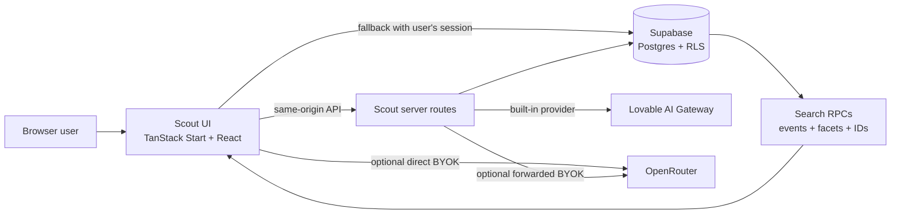

# Scout

**A multi-tenant event discovery and AI workspace for searching live data, exploring results, and building shareable reports.**

Scout combines natural-language search, PostgreSQL full-text and vector retrieval, workspace-scoped event data, conversational AI, and validated interactive result views. Search results come from Supabase. The language model can explain or arrange those results, but it does not create database records or execute generated SQL.

## Contents

- [What Scout does](#what-scout-does)
- [Runtime modes and fallback behavior](#runtime-modes-and-fallback-behavior)
- [Architecture](#architecture)
- [Supabase and live data](#supabase-and-live-data)
- [AI providers and OpenRouter keys](#ai-providers-and-openrouter-keys)
- [Local development](#local-development)
- [Environment configuration](#environment-configuration)
- [HTTP API](#http-api)
- [Security and access control](#security-and-access-control)
- [Deployment and operations](#deployment-and-operations)
- [Troubleshooting](#troubleshooting)
- [Repository conventions](#repository-conventions)

## What Scout does

| Area           | Route         | Capabilities                                                                                                                          |
| -------------- | ------------- | ------------------------------------------------------------------------------------------------------------------------------------- |
| Chat workspace | `/`           | Streaming answers, follow-up context, live event search, saved conversations, model selection, stop/regenerate, and response feedback |
| Search         | `/search`     | Search and filter events by text, category, format, technology, date, city, and free/paid status                                      |
| Dashboards     | `/dashboards` | Save, reopen, duplicate, refresh, and export workspace dashboards                                                                     |
| Team workspace | `/workspace`  | View workspace membership and roles, manage workspace events, and review audit activity                                               |
| Authentication | `/auth`       | Supabase sign-in, account creation, and password reset                                                                                |
| Profile        | `/profile`    | Update profile information and account preferences                                                                                    |
| Administration | `/admin`      | Inspect service health, search/index coverage, and operational metrics                                                                |

Chat can render event cards, KPI summaries, sortable data tables, comparison tables, charts, diagrams, filter forms, dashboards, timelines, kanban boards, checklists, and reports. The UI is selected from an allowlisted component registry and validated against the app's schema before it is rendered.

Search modes expose different ranking behavior:

- **Hybrid** combines vector similarity, PostgreSQL full-text relevance, and metadata matches when embeddings are available.
- **Keyword** uses full-text relevance and metadata.
- **Semantic** prioritizes vector similarity when the server can generate or use embeddings.

Hard filters such as workspace, date, event format, category, city, and technology are applied independently of ranking so a similarity score cannot override them.

## Runtime modes and fallback behavior

The app has a server-backed path and a browser path. The browser path is intended to keep the chat usable when the Scout API server is unavailable; it still needs a browser to load the app and a network connection to reach external services.

| Capability                           | Scout API server available                                   | Scout API server unavailable                                                                                                         |
| ------------------------------------ | ------------------------------------------------------------ | ------------------------------------------------------------------------------------------------------------------------------------ |
| Live public and workspace event data | Server API backed by Supabase                                | Browser queries Supabase directly using the signed-in user's session and database policies                                           |
| Search ranking                       | Hybrid vector, keyword, and metadata ranking when configured | Keyword and metadata ranking; browser mode does not generate vector embeddings                                                       |
| AI response                          | Configured Lovable AI Gateway, or the user's OpenRouter key  | User's OpenRouter key can call OpenRouter directly; otherwise Scout uses deterministic responses and grounded summaries              |
| Chat persistence                     | Supabase for signed-in users; browser storage for guests     | Direct Supabase persistence for signed-in users when permitted; local browser storage is used when persistence is unavailable        |
| Workspace event writes               | Server route can also queue embedding indexing               | Browser can write permitted rows through Supabase RLS; semantic indexing waits until the server and embedding provider are available |
| Email invitations                    | Supported by the workspace API                               | Requires the Scout API server; direct browser membership changes need the invitee's user UUID                                        |

The chat shows a runtime notice when it has switched to browser mode or cannot reach Supabase. If Supabase is unavailable, Scout does not claim that live events were searched. Guest conversation history is local to that browser and is not shared across devices.

OpenRouter's direct browser requests depend on the user's browser/network allowing cross-origin requests. If that path is blocked, run Scout with the API server so it can proxy the request, or use the configured built-in provider. OpenRouter rate limits and free-model availability are controlled by OpenRouter.

## Architecture



### Main code areas

| Path                         | Responsibility                                                                             |
| ---------------------------- | ------------------------------------------------------------------------------------------ |
| `src/routes/`                | Page routes and same-origin HTTP API handlers                                              |
| `src/components/`            | Application shell, chat controls, dialogs, and reusable UI                                 |
| `src/components/dynamic-ui/` | Allowlisted renderers for generated result views                                           |
| `src/lib/client/`            | Browser API client, browser chat fallback, workspace state, and local preferences          |
| `src/lib/server/`            | Server-only search, orchestration, provider, authorization, indexing, and rate-limit logic |
| `src/lib/ai/`                | Intent parsing, conversation helpers, prompt safety, and response composition              |
| `src/lib/events/`            | Event types, filters, and ranking logic shared by search paths                             |
| `src/lib/ui/`                | Dynamic UI schemas and validation                                                          |
| `src/integrations/supabase/` | Supabase client configuration and generated database types                                 |

The app uses TanStack Start file-based routing, React 19, TypeScript, Tailwind CSS, and Vite. The repository's Vite configuration uses the Lovable TanStack config, which supplies the TanStack Start and Nitro integration and a Cloudflare-oriented production build by default.

## Supabase and live data

Supabase is the source of truth for users, workspaces, events, chat history, saved dashboards, feedback, and audit data. The app expects the connected project to expose the schema and row-level security policies that match the generated types in `src/integrations/supabase/types.ts`.

Search uses these existing database RPCs:

- `event_facets(workspace_id)` returns the visible event counts and filter values.
- `search_events(...)` returns events matching the caller's workspace scope, filters, and search terms.
- `get_events_by_ids(event_ids, workspace_id)` reloads previously surfaced results for follow-up turns.

The client uses the Supabase publishable key. That key is designed to be public; database policies must enforce access. A server-only service-role key is used for privileged indexing and server operations where configured. Never put it in a `VITE_*` variable.

### Workspace and event data

Workspace records are scoped through `tenants` and `tenant_members`. Event rows may be public or belong to a workspace. Workspace member roles are `owner`, `admin`, `editor`, `member`, and `viewer`; the database policies and server handlers enforce the permissions for each operation.

When the server is available, creating or updating an event can also queue vector indexing. A direct browser write can still save the permitted event row, but it cannot perform privileged embedding work. The workspace UI reports that indexing is pending until the server path is available.

### Lovable-managed database schema

This repository is connected to Lovable. Database schema and policy changes are managed through Lovable. Do not edit or apply files under `supabase/migrations/` or `drizzle/` by hand. For a schema change, make the change in Lovable and then update the app's generated types through the supported project workflow.

## AI providers and OpenRouter keys

### Built-in provider

The server-backed built-in provider uses the Lovable AI Gateway. The provider key stays on the server. The server also uses the gateway for embedding generation when vector indexing is enabled.

### Bring your own OpenRouter key

Open **AI model settings** in the app, choose **My OpenRouter key**, connect a key, then select one of the free models available for that key. The app checks the key and loads the model list before enabling it.

- The key is kept in that browser's local storage so the preference survives a reload.
- When the app server is available, the browser sends the key in a request header; the server forwards it to OpenRouter and does not save it in the database.
- When the app server is unavailable, the browser can send the request directly to OpenRouter.
- The key is not included in chat history or workspace records. Removing it in model settings clears it from the browser.
- A key in local storage is accessible to scripts running on the same site. Only use a trusted Scout deployment and protect the site against script injection.

Scout uses the chosen model to generate language. Event records and access control still come from Supabase. OpenRouter may enforce per-model availability, quotas, and rate limits, including for free models.

### No configured language model

The app can still parse common search intents and produce deterministic summaries from available database results. That fallback is not a general-purpose LLM. With the API server offline, an OpenRouter key is required for live generative model responses; deterministic chat and grounded search summaries remain available.

## Local development

### Requirements

- Node.js 22 or newer, or Bun 1.2 or newer
- A connected Supabase project with the app's existing schema and policies
- Optional: a configured Lovable AI Gateway for built-in model responses and embedding indexing

### Start the app

1. Copy the example environment file:

   ```sh
   cp .env.example .env
   ```

2. Set the Supabase URL and publishable key for the connected project. Set server-only provider secrets only in the local server environment.
3. Install dependencies and start the dev server:

   ```sh
   bun install
   bun run dev
   ```

4. Open [http://localhost:3000](http://localhost:3000). Check [http://localhost:3000/api/v1/health](http://localhost:3000/api/v1/health) to inspect API and database readiness.

### Common commands

```sh
bun run dev             # Start the local app
bun run build           # Create the production build
bun run preview         # Preview the built app
bun run lint            # Run ESLint
bun run test            # Run the Vitest suite
bun x tsc --noEmit      # Run the TypeScript compiler without emitting files
```

Tests are under `src/test/`. The application has unit and orchestration coverage for filters, ranking, intent parsing, UI validation, prompt safety, and route matching.

## Environment configuration

Use deployment secrets or local `.env` values. Do not commit a real `.env` file. Values prefixed with `VITE_` are exposed to browser builds and must contain public configuration only.

| Variable                                          | Required for                                                                   | Exposure                              |
| ------------------------------------------------- | ------------------------------------------------------------------------------ | ------------------------------------- |
| `VITE_SUPABASE_URL`                               | Browser Supabase client and browser fallback                                   | Public                                |
| `VITE_SUPABASE_PUBLISHABLE_KEY`                   | Browser Supabase client and browser fallback                                   | Public; rely on RLS for authorization |
| `SUPABASE_URL`                                    | Server-side Supabase operations; may also provide the runtime Supabase URL     | Server environment                    |
| `SUPABASE_PUBLISHABLE_KEY`                        | Server-side requests that use the caller's Supabase identity                   | Public key, configured server-side    |
| `SUPABASE_SERVICE_ROLE_KEY`                       | Privileged server operations such as embedding indexing                        | **Secret; server only**               |
| `LOVABLE_API_KEY`                                 | Built-in chat provider and embedding generation                                | **Secret; server only**               |
| `VITE_SUPABASE_PROJECT_ID`, `SUPABASE_PROJECT_ID` | Project metadata used by platform tooling                                      | Public metadata                       |
| `LOVABLE_AI_GATEWAY_URL`                          | Optional Lovable platform configuration; not read directly by current app code | Platform-managed                      |

The exact required settings depend on the runtime path:

- **Browser-only fallback:** `VITE_SUPABASE_URL` and `VITE_SUPABASE_PUBLISHABLE_KEY`; OpenRouter key for direct generative responses.
- **Server-backed app:** Supabase server/public configuration plus the provider secrets needed by the enabled features.
- **Vector indexing:** app server, `LOVABLE_API_KEY`, and server-side database credentials with the required privileges.

Do not use a Supabase secret or service-role key as a publishable key. Do not rename a server secret with the `VITE_` prefix.

## HTTP API

All application API routes are served from the same origin as the app.

| Endpoint                             | Methods                          | Purpose                                                                     |
| ------------------------------------ | -------------------------------- | --------------------------------------------------------------------------- |
| `/api/v1/health`                     | `GET`                            | API, database schema, event availability, and provider configuration status |
| `/api/v1/chat`                       | `POST`                           | Conversational orchestration and SSE streaming                              |
| `/api/v1/chat/sessions`              | `GET`, `POST`                    | List, search, or create chat sessions                                       |
| `/api/v1/chat/sessions/:id`          | `GET`, `PATCH`, `DELETE`         | Read, update, or remove a session                                           |
| `/api/v1/chat/sessions/:id/messages` | `GET`                            | Read session messages and validated UI response data                        |
| `/api/v1/openrouter/models`          | `POST`                           | Validate a user key and fetch available free models                         |
| `/api/v1/search/hybrid`              | `POST`                           | Hybrid event search                                                         |
| `/api/v1/search/semantic`            | `POST`                           | Vector-focused event search                                                 |
| `/api/v1/search/facets`              | `GET`                            | Workspace-visible filter values and counts                                  |
| `/api/v1/search/history`             | `GET`                            | Recent search history                                                       |
| `/api/v1/search/feedback`            | `POST`                           | Submit a search/answer rating                                               |
| `/api/v1/embeddings/status`          | `GET`                            | Inspect event embedding/index coverage                                      |
| `/api/v1/embeddings/generate`        | `POST`                           | Index pending events                                                        |
| `/api/v1/embeddings/reindex`         | `POST`                           | Rebuild event embeddings                                                    |
| `/api/v1/ui/generate`                | `POST`                           | Generate a structured UI response                                           |
| `/api/v1/ui/validate`                | `POST`                           | Validate a UI response against the allowlist                                |
| `/api/v1/ui/artifacts/:id`           | `GET`, `PATCH`                   | Read or update a saved UI artifact                                          |
| `/api/v1/dashboards`                 | `GET`, `POST`                    | List or save dashboards                                                     |
| `/api/v1/dashboards/:id`             | `GET`, `PATCH`, `DELETE`         | Read, update, or remove a dashboard                                         |
| `/api/v1/dashboards/:id/duplicate`   | `POST`                           | Duplicate a dashboard                                                       |
| `/api/v1/dashboards/:id/export`      | `POST`                           | Export dashboard data                                                       |
| `/api/v1/analytics/query`            | `POST`                           | Query authorized analytics dimensions                                       |
| `/api/v1/analytics/aggregate`        | `POST`                           | Compute aggregate metrics                                                   |
| `/api/v1/analytics/metrics`          | `GET`                            | Read operational and search metrics                                         |
| `/api/v1/events`                     | `GET`, `POST`                    | List visible events or create a workspace event                             |
| `/api/v1/events/:id`                 | `PATCH`, `DELETE`                | Update or delete an authorized event                                        |
| `/api/v1/workspaces`                 | `GET`, `POST`                    | List or create workspaces                                                   |
| `/api/v1/workspaces/:id/members`     | `GET`, `POST`, `PATCH`, `DELETE` | List members, invite/add members, and change roles                          |
| `/api/v1/workspaces/:id/audit`       | `GET`                            | Read workspace audit activity                                               |

The health response reports readiness flags, not secret values. A successful HTTP response does not by itself mean the AI provider or every optional capability is configured; inspect the individual fields.

## Security and access control

- **Tenant boundaries:** workspace access is checked using authenticated user identity, membership roles, and Supabase row-level security. The browser publishable key does not grant privileged access.
- **No model-generated SQL:** search and data operations use validated parameters, existing RPCs, and deterministic application code.
- **Prompt safety:** retrieved database rows are treated as untrusted content and are not instructions that can change permissions.
- **Validated UI:** the model can select only registered components. Schemas reject unsupported shapes and values before rendering; raw model-generated JavaScript or HTML is not executed.
- **Server-only secrets:** keep `SUPABASE_SERVICE_ROLE_KEY` and `LOVABLE_API_KEY` in the server environment. Never expose them through `VITE_*`, source code, logs, or committed files.
- **OpenRouter BYOK:** the key is browser-local and transiently forwarded to OpenRouter. It is not written to Supabase.
- **Input controls:** API handlers validate request bodies and apply rate limits to server-backed operations.

Review and test Supabase RLS policies whenever database access paths change. Browser fallback calls are subject to the same policies as any other publishable-key client.

## Deployment and operations

1. Connect the intended Supabase project and ensure the existing app schema, RPCs, auth providers, and RLS policies are available.
2. Set public Supabase URL/key values for the client bundle and server runtime secrets in the deployment environment.
3. Configure `LOVABLE_API_KEY` if built-in chat or embedding generation is required. OpenRouter keys are provided per user in AI model settings.
4. Build using `bun run build` and deploy with the Nitro target configured for the hosting platform. The default Lovable Vite configuration is Cloudflare-oriented.
5. After deployment, check `/api/v1/health`, sign in, verify workspace membership, and run a live search against the connected Supabase project.

Operational notes:

- If the server is unavailable, browser fallback is limited by the user's Supabase session, RLS grants, browser connectivity, and OpenRouter cross-origin access.
- Vector search and embedding maintenance require the app server and embedding provider. Keyword and metadata search remain available when vectors are unavailable.
- Server rate limits and telemetry are applied to API requests. Direct Supabase browser operations are governed by Supabase policies and platform limits.
- Back up and monitor the connected Supabase project using the organization's Supabase/Lovable procedures.

## Troubleshooting

| Symptom                                               | Check                                                                                                                                                                                                                         |
| ----------------------------------------------------- | ----------------------------------------------------------------------------------------------------------------------------------------------------------------------------------------------------------------------------- |
| App reports missing Supabase configuration            | Confirm `VITE_SUPABASE_URL` and `VITE_SUPABASE_PUBLISHABLE_KEY` in the client build environment. For the server, also check `SUPABASE_URL` and `SUPABASE_PUBLISHABLE_KEY`. Rebuild after changing build-time `VITE_*` values. |
| `/api/v1/health` reports schema not ready             | Verify the deployment points at the intended Supabase project and that the project has the existing Scout schema and `events` table. Manage schema through Lovable.                                                           |
| Live event count is zero                              | Check whether events are present and published, then confirm workspace selection and membership. A healthy schema can legitimately have no visible events.                                                                    |
| Private workspace search is denied                    | Sign in with a user who belongs to that workspace and confirm the member role and RLS policies.                                                                                                                               |
| Chat works but gives deterministic answers            | Configure the built-in server provider or connect an OpenRouter key in AI model settings.                                                                                                                                     |
| OpenRouter model list cannot load                     | Recheck the key, network access, and OpenRouter availability. With no app server, browser CORS/network policy may prevent the direct request.                                                                                 |
| Browser fallback says Supabase is unavailable         | Check the browser Supabase URL/key, network access, current auth session, and database RLS/RPC permissions.                                                                                                                   |
| Workspace event is saved but not semantically indexed | Restore the app server, gateway key, and server-side indexing credentials, then run the authorized pending-index operation.                                                                                                   |
| Chat history is missing on another device             | Guest sessions are local to one browser. Sign in and confirm Supabase persistence is available for cross-device history.                                                                                                      |

## Repository conventions

- Keep the connected branch in a working state. Commits pushed to it sync back to Lovable; do not rewrite published history.
- Database schema and policy changes belong in Lovable. Do not add or edit `supabase/migrations/` or `drizzle/` by hand.
- Do not hand-edit generated files, including files marked as generated and `src/routeTree.gen.ts`.
- Keep server secrets out of the repository. Use `.env.example` for placeholder names and local deployment documentation only.
- Routes are file-based under `src/routes/`; the root layout is `src/routes/__root.tsx`.
